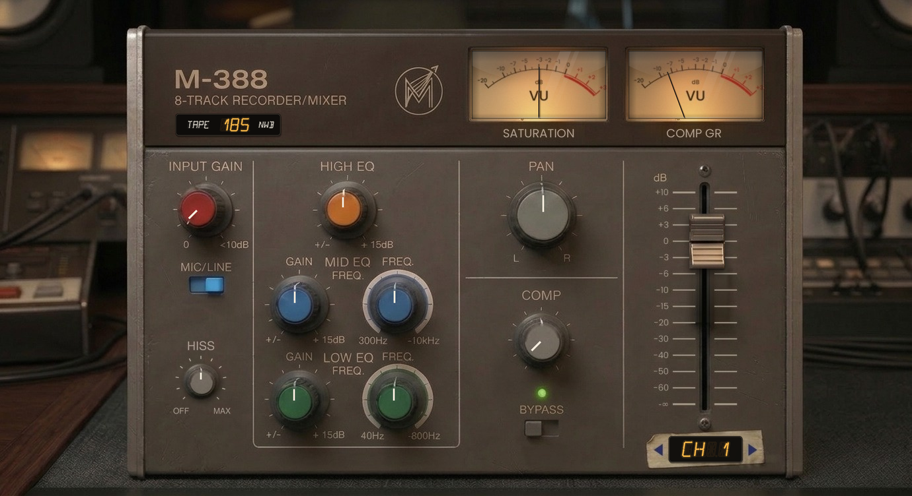

# M-388 Tape Console (VST3)

Emulazione di un canale di registratore/mixer a 8 tracce a nastro: 8 canali con carattere diverso (risposta in frequenza,
rumore, ritardo, drive), saturazione a nastro con isteresi, INPUT GAIN con autogain (volume costante, VU rossi in
sovraccarico), EQ di canale a 3 bande, pan, fader e manopola COMP (dry/wet di un compressore VCA 6:1, attacco lento, rilascio veloce). Velocita' nastro fissa a 7.5 ips come l'originale. Una sola schermata.

## Come ottenere il VST3 (senza installare nulla)
1. Crea un repository vuoto su GitHub e carica **tutto il contenuto di questa cartella** (compresa `.github/`).
2. Vai nella scheda **Actions**: parte da solo il workflow *Build VST3* (oppure *Run workflow*).
3. Quando e' verde, apri l'esecuzione e scarica da **Artifacts**: `M388-VST3-Windows` e `M388-VST3-macOS`.
4. Copia la cartella `M-388 Tape Console.vst3` dove il tuo host cerca i VST3:
   - Windows: `C:\Program Files\Common Files\VST3`
   - macOS: `~/Library/Audio/Plug-Ins/VST3` (plugin non firmato: se bloccato, `xattr -cr "M-388 Tape Console.vst3"`)

### Release automatica (facoltativa)
Se crei un tag che inizia con `v` (es. dalla pagina **Releases > Draft a new release**, tag `v0.2.0`), il workflow
pubblica da solo una Release con gli zip Windows e macOS da scaricare direttamente.

## Build in locale
    cmake -B build -DCMAKE_BUILD_TYPE=Release
    cmake --build build --config Release --target M388_VST3
(la prima volta scarica JUCE 8.0.4 da GitHub; serve un compilatore C++17)

## Struttura
- `Source/TapeCore.h`  nucleo DSP senza dipendenze (testato: `Tests/dsp_test.cpp`, incluso il test anti-gate)
- `Source/PluginProcessor.*`  parametri (APVTS), elaborazione stereo, pan = bilanciamento, bypass
- `Source/PluginEditor.*`  interfaccia: console, manopole, fader, VU con rosso in sovraccarico
- `Source/Geometry.h`, `ParamTable.h`  coordinate dei controlli (immagine 1380x752) e tabella dei parametri
- `Assets/`  immagini dell'interfaccia (incorporate nel plugin)
- `Tests/preview.py`  rigenera l'anteprima (`preview.png`) e i VU animati con lo stesso disegno del plugin (serve Python con Pillow e numpy)

## Uso
Trascina le manopole in verticale e il fader su/giu' (Shift = regolazione fine; mentre trascini compare il valore);
doppio clic su una manopola = valore iniziale, sul fader = 0 dB; anche la rotella del mouse muove manopole e fader. Tocca `<` `>` sul nastro adesivo per cambiare canale (1-8);
tocca l'interruttore BYPASS per escludere il plugin. Tutti i parametri sono automatizzabili.
La levetta MIC/LINE cambia il preamp d'ingresso: LINE e' pulito, MIC aggiunge un po' di drive, trasformatore e armoniche pari (il livello resta lo stesso grazie all'autogain).

## Note
Il modello e' tarato dal grafico di risposta in frequenza fornito (fit a 11 filtri, errore medio 0,19 dB; le differenze fra i canali derivano dalla dispersione delle curve) e a orecchio, non su misure di un 388 reale.
Latenza dichiarata all'host: ~38 campioni (oversampling 4x a mezze bande + ritardo di canale).
CPU: circa 1,3% di un core per canale a 48 kHz (misurato in un banco di prova, ~2,7 volte meno della versione precedente); a COMP = 0 il compressore non consuma nulla e gli stadi EQ/MIC a zero vengono saltati.

INPUT GAIN: 0..+10 dB. COMP: 0 = segnale pulito, 1 = tutto compresso (parallelo, con recupero del livello).

Meter: quello di sinistra mostra la saturazione (diventa rosso quando e' troppa), quello di destra la riduzione di guadagno del compressore.
Fader: movimento lento e "duro" (Shift = ancora piu' fine), doppio clic = 0 dB, fondo corsa = -inf (muto).
Ogni nuova istanza prende in automatico il primo canale libero (1-8) fra quelle aperte nello stesso processo; il canale salvato nel progetto ha la precedenza. La finestra si apre a 1242x677 ed e' ridimensionabile.

## Novita' 0.2.0
- **Bypass corretto**: prima, in bypass il segnale usciva senza la latenza dichiarata (fuori tempo rispetto alle altre
  tracce) e al rientro usciva un frammento di audio vecchio rimasto nel nastro. Ora il segnale asciutto e' ritardato
  della stessa latenza, il passaggio e' una dissolvenza di 20 ms senza click, e il bypass dell'host comanda l'interruttore BYPASS.
- **Pan senza scatti** durante l'automazione (variazione morbida di 30 ms).
- **Fader a fondo corsa = muto vero** (-inf), come indicato dalla scala.
- **Valori leggibili** nell'host e nell'interfaccia (dB, Hz/kHz, L/C/R, %), anche digitabili.
- **Interfaccia**: valore visibile durante il trascinamento, Shift fine anche sulle manopole, doppio clic = valore
  iniziale, rotella del mouse; ridisegno solo delle parti che cambiano (molta meno CPU grafica a finestra grande).
- Workflow: release automatica sui tag `v*`. Nuovi test: fader muto e stabilita' da 22 a 192 kHz su tutti gli 8 canali.

## Novita' 0.2.1
- **Effetto vetro sui VU**: ombra interna della cornice (il vetro e' incassato), riflesso curvo in alto, due strisce
  speculari diagonali e un filo di luce sul bordo basso. Il vetro sta sopra l'ago, che prende anch'esso il riflesso.
- **Anteprima** dell'interfaccia (`preview.png`) e script per rigenerarla.

## Novita' 0.2.2
- **Targhetta con il valore** sopra il pomello mentre lo muovi (trascinamento, rotella, doppio clic): le frequenze
  dell'EQ si leggono subito (es. MID FREQ 2.40 kHz, LOW FREQ 120 Hz). Bordo del colore del pomello, cifre ambra;
  resta visibile 1 secondo dopo il rilascio e poi svanisce. Vale per tutti i controlli, fader compreso.
- `Tests/preview.py` genera anche `preview_eq_mid.png` e `preview_eq_low.png`.

## Novita' 0.2.3
- **Display anni '80** nella targhetta dei valori: carattere alfanumerico a 14 segmenti disegnato a vettori
  (`Source/SegmentFont.h`, nessun file di font), cifre ambra con alone, segmenti spenti appena visibili e leggera
  inclinazione, come i display dei registratori e dei synth dell'epoca. Etichetta nel colore del pomello.

## Novita' 0.2.4
- Numero del canale in una finestrella con lo stesso display anni '80 (ambra), fra le due frecce del nastro adesivo.

## Novita' 0.2.5
- Corretto l'errore di compilazione in `PluginEditor.cpp` (parentesi graffa in piu').
- Build solo per Windows e macOS (Linux rimosso).

## Novita' 0.3.0
- **TAPE LEVEL** (livello operativo del nastro), finestrella sotto "8-TRACK RECORDER/MIXER": 185 / 250 / 320 / 500 nWb/m,
  cioe' +0 / +2.6 / +4.8 / +8.6 dB di spinta sul nastro oltre a INPUT. Clic = valore successivo, Shift+clic = precedente.
  Serve per saturare le tracce singole, che in un mix a 0 VU stanno molto piu' basse (es. -12 VU): con 500 nWb/m e
  INPUT +10 una traccia a -12 VU satura circa 4 volte di piu' (THD 1 kHz da 1,2% a 4,6%; con MIC 9,6%).
  Predefinito 185 = suono identico alle versioni precedenti. Anche questo valore e' automatizzabile dall'host.

## Novita' 0.3.1
- **Pomello HISS** sotto MIC/LINE: OFF = nastro silenzioso; ore 12 = fruscio normale del canale (come prima, i progetti
  salvati non cambiano); MAX = +12 dB. Targhetta col valore mentre lo giri. Automatizzabile dall'host.
